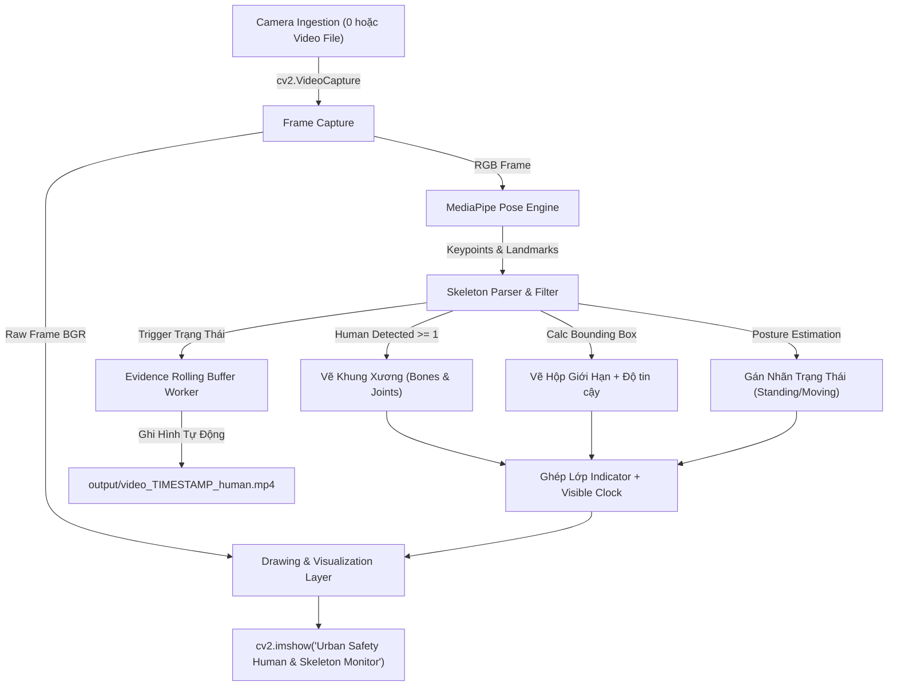
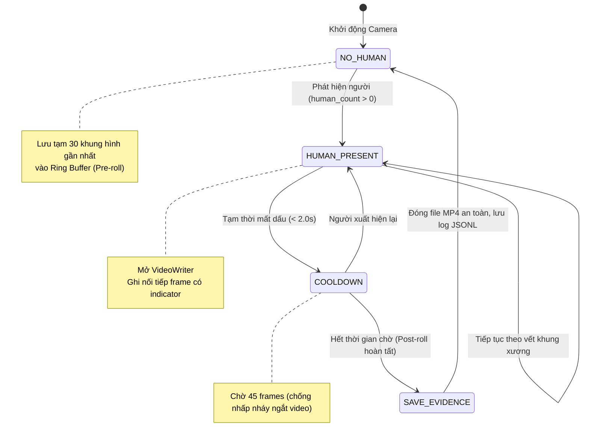

# ĐẶC TẢ KỸ THUẬT: ỨNG DỤNG GIÁM SÁT & PHÁT HIỆN CON NGƯỜI TỪ CAMERA (REAL-TIME SKELETON INDICATOR)
**Mã tài liệu:** `SPEC-HUMAN-DETECT-01` (Cập nhật phiên bản v1.1 theo yêu cầu User)  
**Dự án:** Hệ thống Giám sát An ninh & An toàn Đô thị Thông minh (Urban Safety AI-SOC)  
**Phân hệ:** Tầng 1 (Input & Ingestion) & Tầng 2 (AI/CV Detection & Pose Skeleton Analytics)  

**Cơ sở tham chiếu:** Repository `https://github.com/g4lb/camera-recorder-with-human-detection`

---

## 1. MỤC TIÊU & BỐI CẢNH (OBJECTIVES & CONTEXT)

### 1.1. Mục tiêu Nâng cấp
1. **Dựa trên nền tảng repo gốc:** Tái cấu trúc và cải tiến từ mô hình ghi hình offline (`camera_recorder.py` + `human_detection.py`) thành **Hệ thống Phát hiện Thời gian thực trực tiếp từ Camera (Real-time Live Detection)**.
2. **Hiển thị Bộ chỉ báo Khung xương (Skeleton & Indicator Overlay):**
   - Vẽ khung xương (pose skeleton keypoints & connecting bones: vai, khuỷu tay, cổ tay, hông, đầu gối, cổ chân) trực tiếp lên từng cơ thể người trong thời gian thực.
   - Hiển thị các chỉ báo SOC (Indicators): Bounding Box, Pose Confidence, Human Count, Trạng thái vận động (Đứng/Ngồi/Di chuyển), và Đồng hồ Thời gian thực kiểm toán (Visible Clock Overlay).
3. **Tương thích hoàn hảo với môi trường Windows & Python 3.15:**
   - Ứng dụng giải pháp Pose Estimation siêu nhẹ (`mediapipe` kết hợp OpenCV) đạt 25–30 FPS mượt mà trên CPU mà không đòi hỏi GPU rời hay PyTorch cồng kềnh.
   - Lưu trữ tự động video clip bằng chứng trích xuất trực tiếp bằng OpenCV `VideoWriter` vào `output/` khi phát hiện người.
   - Vẫn bảo toàn khả năng quét hàng loạt các video có sẵn trong `records/` để giữ tính tương thích ngược với repo gốc.

---

## 2. ĐỊNH NGHĨA DỮ LIỆU & DATA SCHEMAS

### 2.1. Cấu trúc Khung xương & Bounding Box (Pose & Detection Schema)

```python
from dataclasses import dataclass, field
from typing import List, Tuple, Optional
from datetime import datetime

@dataclass
class Keypoint:
    id: int
    name: str
    x: int           # Tọa độ pixel trục X
    y: int           # Tọa độ pixel trục Y
    z: float         # Độ sâu tương đối
    visibility: float # Điểm tin cậy (0.0 - 1.0)

@dataclass
class HumanPose:
    track_id: int
    bbox: Tuple[int, int, int, int]  # (x, y, w, h)
    confidence: float
    keypoints: List[Keypoint] = field(default_factory=list)
    posture_label: str = "Standing"  # Standing, Sitting, Moving, Low Mobility

@dataclass
class FrameAnalysisResult:
    frame_index: int
    timestamp: str  # ISO-8601 UTC
    human_count: int
    humans: List[HumanPose] = field(default_factory=list)
    inference_time_ms: float = 0.0
    is_recording_evidence: bool = False

@dataclass
class HumanIncidentClip:
    event_id: str
    source_video: str
    start_time: str
    end_time: str
    start_frame: int
    end_frame: int
    duration_seconds: float
    output_filepath: str
```

### 2.2. Quy tắc Nối Xương (Skeleton Connections)
Hệ thống kết nối 33 điểm mốc sinh học thành các đoạn xương chuẩn:
- **Thân trên (Torso):** Vai trái ↔ Vai phải ↔ Hông phải ↔ Hông trái ↔ Vai trái.
- **Tay trái (Left Arm):** Vai trái ↔ Khuỷu tay trái ↔ Cổ tay trái.
- **Tay phải (Right Arm):** Vai phải ↔ Khuỷu tay phải ↔ Cổ tay phải.
- **Chân trái (Left Leg):** Hông trái ↔ Đầu gối trái ↔ Cổ chân trái.
- **Chân phải (Right Leg):** Hông phải ↔ Đầu gối phải ↔ Cổ chân phải.

---

## 3. SƠ ĐỒ LUỒNG DỮ LIỆU & MÁY TRẠNG THÁI

### 3.1. Sơ đồ Luồng Xử lý Thời gian thực (Real-time Pipeline)



### 3.2. Máy Trạng thái Ghi hình Bằng chứng (Evidence Clip State Machine)



---

## 4. RÀNG BUỘC KỸ THUẬT & KIỂM THỬ

1. **Hiệu năng:** Độ trễ từ lúc camera chụp đến khi vẽ xong khung xương trên màn hình $\le 45\text{ms}$ (~22–30 FPS trên CPU).
2. **Không lỗi phụ thuộc:** Sử dụng gói `mediapipe` và `opencv-python` đã xác thực tương thích với Python 3.15.
3. **Phím bấm điều khiển:**
   - Phím `q`: Thoát ứng dụng an toàn.
   - Phím `s`: Chụp ảnh nhanh (Snapshot) kèm đầy đủ xương và chỉ báo.
   - Phím `r`: Bật/Tắt chế độ ghi hình thủ công.

---

[APPROVED]
