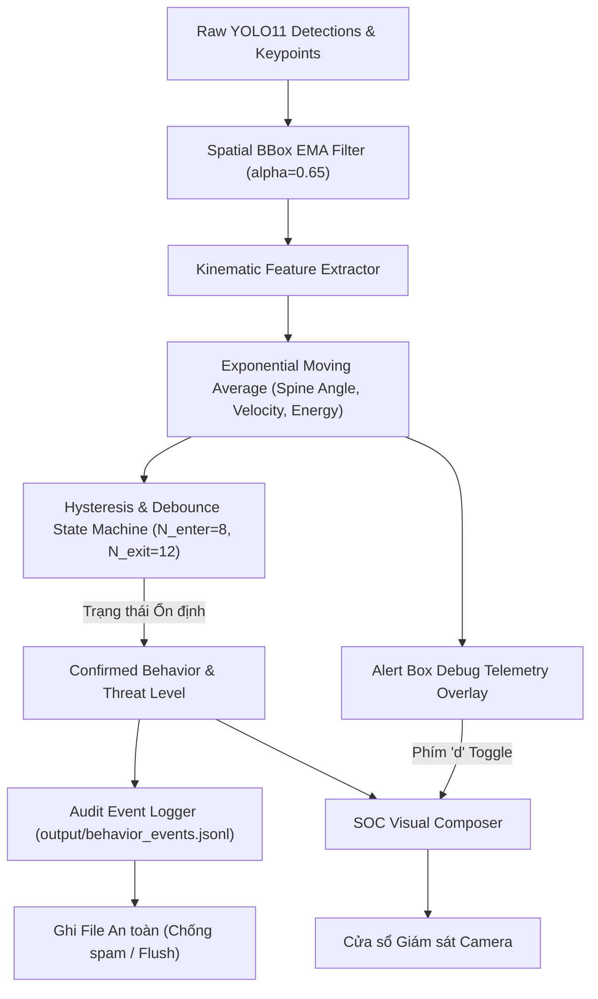
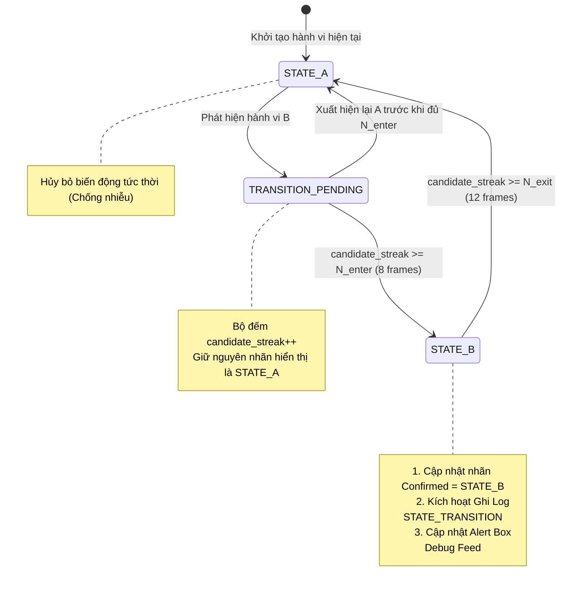

# ĐẶC TẢ KỸ THUẬT: GHI NHẬT KÝ KIỂM TOÁN, ALERT BOX DEBUG & KHỬ NHẢY ĐỐI TƯỢNG (ANTI-FLAPPING & BOX STABILIZATION)
**Mã tài liệu:** `SPEC-BEHAVIOR-STABILIZATION-02`  
**Dự án:** Hệ thống Giám sát An ninh & An toàn Đô thị Thông minh (Urban Safety AI-SOC)  
**Phân hệ:** Tầng 2 (AI Analytics), Tầng 3 (Dynamic Threat Scoring), Tầng 5 (Audit & Observability)  
**Cơ chế thực thi:** Spec-Driven Development (SDD) — Giai đoạn 1 (Stage 1 Specification)  
**Trạng thái:** Chờ phê duyệt từ Lead Architect (`[WAITING FOR SPEC APPROVAL]`)

---

## 1. MỤC TIÊU & YÊU CẦU KỸ THUẬT

Theo yêu cầu từ Lead Developer, hệ thống cần giải quyết 3 bài toán trọng tâm:

1. **Ghi Nhật ký Hành động Kiểm toán (Audit Action Logging):**
   - Mọi lần hệ thống phát hiện hành vi, phân loại sự cố hoặc leo thang mức độ đe dọa đều phải được lưu trữ tức thời vào file nhật ký kiểm toán chuẩn SOC (`output/behavior_events.jsonl` và `output/behavior_audit.log`).
   - Cung cấp cơ chế chống tràn log (Anti-Spam / Rate Limiting): Chỉ ghi log khi có chuyển đổi trạng thái (`STATE_TRANSITION`), khi có sự cố nghiêm trọng (`CRITICAL_ALERT`), hoặc heartbeat định kỳ (1.0s/lần) cho sự cố đang tiếp diễn.

2. **Bổ sung Alert Box Debug (Real-Time Diagnostic Panel):**
   - Hiển thị một khung bảng điều khiển Debug trực quan trên giao diện giám sát (Debug HUD Box).
   - Trực quan hóa dữ liệu đo xa sinh trắc học thời gian thực (Live Telemetry): Góc nghiêng cột sống ($\theta_{\text{spine}}$), Tỷ lệ co cụm cơ thể ($H/W$), Vận tốc dịch chuyển chuẩn hóa ($V_{\text{norm}}$), Động năng cổ tay ($E_{\text{wrist}}$), Thời gian duy trì trạng thái (Dwell Time), và Nhật ký 3 cảnh báo mới nhất (Live Alert Feed).
   - Hỗ trợ phím tắt `[d]` để Bật/Tắt (Toggle) khung Debug Box này mà không làm che khuất video camera.

3. **Khử Triệt để Hiện tượng Nhảy Mark Đối tượng (Anti-Flapping & Spatial Stabilization):**
   - **Hiện tượng 1 (Nhảy nhãn hành vi - Behavior Label Flapping):** Nhãn bị đổi liên tục giữa các khung hình (ví dụ: `NORMAL` $\leftrightarrow$ `CROUCHING` hoặc `NORMAL` $\leftrightarrow$ `FALLEN`) do nhiễu tư thế nhất thời.
     - *Giải pháp:* Áp dụng máy trạng thái trễ (Hysteresis State Machine) kết hợp bộ làm mịn trung bình động hàm mũ (Exponential Moving Average - EMA) cho các tham số góc nghiêng và vận tốc. Yêu cầu ít nhất $N_{\text{enter}} = 8$ khung hình liên tiếp để xác nhận trạng thái mới và $N_{\text{exit}} = 12$ khung hình để hoàn nguyên.
   - **Hiện tượng 2 (Rung giật Bounding Box - Spatial Jittering):** Khung bao đối tượng bị co giãn, giật biên độ nhỏ liên tục giữa các frame.
     - *Giải pháp:* Áp dụng bộ lọc EMA Smoothing cho tọa độ hộp bao:
       $$\text{bbox}_{t} = \alpha \cdot \text{bbox}_{\text{raw}} + (1 - \alpha) \cdot \text{bbox}_{t-1} \quad (\alpha \approx 0.65)$$
   - **Hiện tượng 3 (Mất dấu/Tráo ID - ID Flapping):** ByteTrack được tinh chỉnh tham số `lost_track_buffer = 45` và `minimum_matching_threshold = 0.80` để giữ ổn định định danh khi đối tượng quay lưng hoặc bị che khuất tạm thời.

---

## 2. ĐỊNH NGHĨA DỮ LIỆU & SCHEMA (STRICT STRUCTURED OUTPUT)

### 2.1. Cấu trúc Bản ghi Nhật ký Kiểm toán (Audit Log Schema)

```python
from dataclasses import dataclass, field
from typing import Dict, Any, Optional
from datetime import datetime


@dataclass
class BehaviorAuditLogEntry:
    """Bản ghi sự kiện kiểm toán hành vi lưu vào JSONL/Log file chuẩn SOC."""
    event_id: str                      # Mã UUID duy nhất: EVT_YYYYMMDD_HHMMSS_TRACKID
    timestamp: str                     # ISO-8601: YYYY-MM-DD HH:MM:SS.mmm
    frame_index: int                   # Chỉ số khung hình video
    track_id: int                      # ID đối tượng
    event_type: str                    # STATE_TRANSITION | THREAT_ESCALATION | CRITICAL_ALERT | HEARTBEAT
    previous_behavior: Optional[str]   # Hành vi trước đó
    current_behavior: str              # Hành vi hiện tại
    threat_level: str                  # LOW | MEDIUM | HIGH | CRITICAL
    threat_score: float                # 0.00 đến 1.00
    telemetry: Dict[str, float]        # {"spine_angle": 72.1, "aspect_ratio": 0.65, "speed": 0.1, "wrist_energy": 240.0}
    reasoning: str                     # Diễn giải suy luận kiểm toán
    dwell_time_seconds: float          # Thời gian duy trì hành vi
```

### 2.2. Trạng thái Động học Khử rung (Telemetry & Stabilization State)

```python
@dataclass
class StabilizedTrackKinematics:
    """Dữ liệu động học đã được làm mượt qua bộ lọc EMA và Hysteresis."""
    track_id: int
    smooth_bbox: Tuple[int, int, int, int]
    smooth_spine_angle: float
    smooth_aspect_ratio: float
    smooth_speed: float
    smooth_wrist_energy: float
    confirmed_behavior: str
    behavior_candidate: str
    candidate_streak: int
    state_dwell_seconds: float
```

---

## 3. SƠ ĐỒ LUỒNG DỮ LIỆU & MÁY TRẠNG THÁI (DATA FLOW & MERMAID)

### 3.1. Sơ đồ Luồng Khử rung, Debug HUD và Ghi Log



### 3.2. Máy Trạng thái Chống Nhảy Nhãn (Anti-Flapping State Machine)



---

## 4. CHI TIẾT THIẾT KẾ ALERT BOX DEBUG HUD

Bảng Debug HUD được vẽ bằng OpenCV overlay với độ mờ nền 85% (Semi-transparent dark panel):
- **Vị trí:** Góc dưới bên trái khung hình (kích thước $360 \times 160\text{px}$).
- **Nội dung hiển thị:**
  1. Tiêu đề: `[ SOC DIAGNOSTIC TELEMETRY - TOGGLE 'd' ]`
  2. Bảng theo vết đối tượng (tối đa 4 người gần nhất):
     `ID#1: Ang=12° | Spd=0.2 | H/W=2.1 | NORMAL [LOW]`
     `ID#2: Ang=68° | Spd=0.0 | H/W=0.7 | FALLEN [CRITICAL 98%]`
  3. Dòng tin tức sự cố mới nhất (Live Alert Ticker):
     `LAST EVENT: [18:03:02] ID#2 TRANSITION -> FALLEN (Dwell: 2.1s)`
- **Màu sắc trạng thái:** Nhãn được tô màu tự động theo mức đe dọa (Xanh lá / Vàng / Cam / Đỏ).

---

## 5. RÀNG BUỘC KỸ THUẬT & KIỂM THỬ (CONSTRAINTS & TESTS)

1. **Hiệu năng & I/O Bất đồng bộ:**
   - Việc ghi log ra file sử dụng bộ đệm ghi an toàn (`buffering=1` hoặc periodic flush), không làm giảm FPS của vòng lặp camera (độ trễ I/O $\le 0.5\text{ms}$).
2. **Kiểm thử Đơn vị Bổ sung:**
   - `test_anti_flapping_filter()`: Bơm chuỗi 5 frames nhiễu bất chợt (ví dụ 1 frame người cúi xuống khi đang đi) $\to$ Nhãn hiển thị vẫn được giữ vững là `NORMAL`.
   - `test_audit_logger()`: Kiểm tra file `behavior_events.jsonl` được tạo ra đúng cấu trúc JSON hợp lệ, chứa đầy đủ metadata kiểm toán.
   - `test_debug_hud_toggle()`: Xác nhận phím tắt `d` thay đổi trạng thái hiển thị Debug Box trơn tru.

---

[WAITING FOR SPEC APPROVAL]
